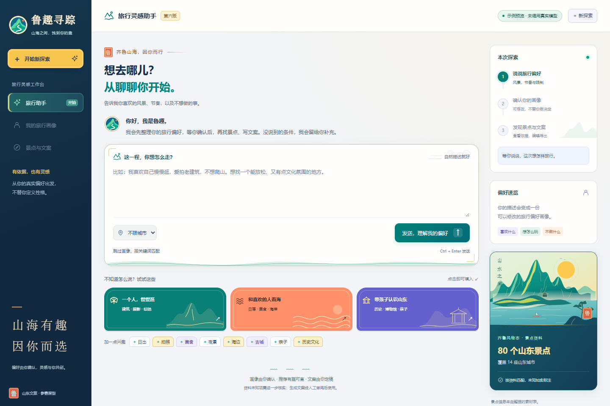

# 鲁趣寻踪 · 第六版

### 用户偏好画像 × 景点推荐 × 文旅传播素材配套

**山海有趣，因你而选。**

鲁趣寻踪是一款面向山东文旅场景的营销传播工具。针对海量景点信息带来的选择成本，工具将用户主动表达的性格特点、旅行偏好与限制整理成可确认的画像，从80条、覆盖14座城市的山东景点资料中推荐目的地，并配套景点图片、传播标题与短文案，辅助游客发现目的地，也帮助文旅内容创作者形成面向不同受众的选题与内容。

项目目标是提高目的地匹配与文旅内容传播效率；当前未完成充分的效率对比测量，不宣称已验证的提升比例或精准率。

<!-- demo-video:start -->
## 演示视频

第六版正式演示：**真人配音 · 2分42.5秒 · 1080p / 60帧**。

[](https://github.com/Tomberryyyy/luqu-xunzong/releases/download/v6.0.0/luqu-xunzong-v6-demo.mp4)

**[下载完整演示视频（MP4，约25 MB）](https://github.com/Tomberryyyy/luqu-xunzong/releases/download/v6.0.0/luqu-xunzong-v6-demo.mp4)** · [下载中文字幕（SRT）](https://github.com/Tomberryyyy/luqu-xunzong/releases/download/v6.0.0/luqu-xunzong-v6-demo.zh-CN.srt) · [第六版发布页](https://github.com/Tomberryyyy/luqu-xunzong/releases/tag/v6.0.0)

演示涵盖自然语言偏好描述、六维画像确认、景点匹配依据、图片与传播文案配套、人工修改导出，以及冲突提示与修正。模型标识 `gpt-6.1-sol` 已在画像章节标明。实机部分回放此前获得的真实模型结果，接口等待经过剪辑。

点击封面或上方链接获取完整视频；程序运行步骤见下方“快速开始”。
<!-- demo-video:end -->

## 界面预览



*界面截图为模拟模式的首页预览，没有发送真实模型请求，不是三组真实测试的结果证明。*

## 快速开始

1. 点击仓库右侧 **Releases**，下载第六版运行压缩包；也可通过 **Code → Download ZIP** 下载源码。
2. 完整解压。电脑需要Python 3.8或更高版本，运行后端不需要安装第三方Python库。
3. Windows双击 `start_windows.bat`，浏览器打开 **http://127.0.0.1:8006**。使用时保留启动窗口。
4. 首次默认是明确标示的演示模式。接入真实模型的步骤见[启动与配置](docs/QUICKSTART.md)。

macOS / Linux：在项目目录执行 `python3 server.py`，再打开上述本地网址。

GitHub仓库与下载包用于分发项目；当前没有对外在线托管的Python后端。`127.0.0.1`只能由启动程序的电脑访问。

## 解决的传播痛点

- **景点信息过载**：从大量景点介绍转向“先理解偏好，再提供候选”。
- **泛化推荐难解释**：把符合、尚不能确认、不符及资料依据展示出来。
- **选景与内容脱节**：将确认后的画像传给文案生成环节，提供图片、标题与短文案配套。
- **AI初稿难复核交付**：支持人工编辑、审阅标记、复制和TXT / JSON导出，保留初稿与修改稿。

## 从输入到成果

**自然语言描述 → 六维画像 → 人工确认 → 有依据的景点匹配 → 图片与传播文案 → 人工定稿与导出**

| 环节 | 当前能力 |
| --- | --- |
| 偏好理解 | 提取同行、环境、节奏、体力、内容兴趣及明确排除项，附用户表述依据 |
| 用户控制 | 六个维度可修改或删除；未表达内容保持“未说明” |
| 推荐与解释 | 城市筛选、同义词和组合兴趣、排除优先、条件冲突提示，以及符合／未知／不符的说明 |
| 素材配套 | 展示已有景点配图，生成传播标题与约80–120字文案；目前覆盖图片与文字，不包含音视频生成 |
| 人工协作 | 编辑标题与文案、对照资料审阅、复制或导出TXT / JSON |
| 容错 | 请求失败提示、文案生成重试；重新探索前需手动导出保留记录 |

## 接入的大模型

本项目当前演示配置使用的模型标识是 **`gpt-6.1-sol`**，通过 **OpenAI 兼容的 Chat Completions 接口**调用。该标识同时见于本地运行配置与保存的真实运行记录；这里记录接入服务使用的模型名称，运行时以本地 `LLM_MODEL` 配置为准。

| 大模型参与的环节 | 输入与输出 |
| --- | --- |
| 六维旅行偏好画像 | 根据用户自然语言提取同行、环境、节奏、体力、兴趣与排除项，保留表述依据；未表达内容标为“未说明” |
| 传播文案起草 | 结合用户确认的画像、已匹配景点资料及排除项，生成传播标题与短文案，供人工审阅、编辑和导出 |

景点候选的筛选、排序、排除优先与冲突检测由本地规则完成；景点图片来自已有素材链接。当前不包含大模型生成图片或视频。

使用真实接口时，在本地 `.env` 中设置 `LLM_MODEL=gpt-6.1-sol`，并配置自己的接口地址与密钥，将 `LLM_MOCK` 设为 `0` 后重启。`LLM_MODEL` 可按接入服务支持的模型修改；下载包默认仍是明确标示的演示模式，不含密钥。配置步骤见[启动与模型配置](docs/QUICKSTART.md)。

## AI与规则的分工

- **大模型**：将自由描述提取为结构化画像；根据画像与景点资料起草标题、文案。
- **本地规则**：根据标签、同义词与有依据的属性筛选、排序，优先处理排除条件。
- **人**：确认偏好、核实来源、检查配图与文案、决定修改和发布。

本项目以“精准匹配”作为改进目标，当前推荐基于有限资料与规则；没有声称已实现心理测评、经验证的人格预测或向量检索RAG。不会仅凭“内向”推断怕人多、低体力等未表达偏好。

## 输入示例

> 我比较内向，喜欢自己慢慢逛，爱拍老建筑，这次不想爬山。

> 我和朋友想去青岛海边，喜欢拍照和美食，行程轻松一点，不想爬山。

> 我想带孩子了解山东历史，喜欢博物馆，安排不要太赶。

以上是输入示例，实际提取与推荐以运行结果为准。资料没能证明的条件会保留为“尚不能确认”。

## 工程结构

```text
server.py                 本地服务、画像与文案接口、静态访问白名单
launch_windows.py         Windows启动辅助
start_windows.bat         一键启动
.env.example              空白配置模板，默认演示模式
static/                   第六版界面、匹配规则与导出逻辑
data/attractions.json     80条山东景点资料
data/attributes.json      带证据与未知状态的匹配属性
scripts/                  资料导入辅助与本地规则检查
docs/                     使用、数据与素材、AI应用及检查说明
```

## 检查与当前状态

使用Node.js可运行 `node scripts/check_data.cjs`，检查80条资料、14城市、组合兴趣、排除和冲突等15项规则；不调用真实模型。Python后端仅用标准库，Node.js不是正常运行程序的必需条件。

本地已做模拟界面与导出检查。用户反馈三组案例已操作，但未保留完整截图；本仓库不会将模拟截图或开发检查冒充三组真实案例。真实接口表现、事实核验及素材许可仍需按具体使用场景复核。

## 数据、素材与公开使用

数据由团队提供的景点Excel整理，部分来源目前只有官网首页；表格核验日期不代表已独立核验全部事实。景点图片为外部链接，未打包第三方照片；表格中的授权备注不等于已取得许可证明。详见[数据与素材说明](docs/DATA_AND_ASSETS.md)。

本仓库未授予第三方素材的再使用许可；代码的使用授权以权利人后续明确声明为准。需要对外发布图文内容时，请先核查实际素材许可与事实来源。

## 更多说明

- [启动与模型配置](docs/QUICKSTART.md)
- [数据与素材说明](docs/DATA_AND_ASSETS.md)
- [AI应用与人机协作](docs/AI_USAGE.md)
- [验证记录与适用边界](docs/VALIDATION.md)

参赛方向：山东省首届大学生AI大模型创新传播大赛 · 赛道三（AI传播工具创新）。仓库公开便于项目展示与评审，不代表比赛报名或提交已经完成。
